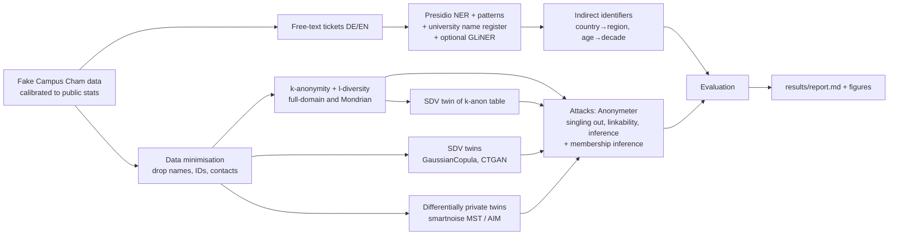

# campus-cham-privacy

Prototype for **Learning Journal 1, use case 1 (confidential big data)**, *AI for Practical Use Cases*, THD Campus Cham, WS 26/27.
Approved by the lecturer on 4 Nov 2026 to go in the journal appendix.

It shows how campus data can be made analysable without exposing anyone, and tests every release against the three
GDPR anonymisation criteria (Article 29 Working Party, Opinion 05/2014: singling out, linkability, inference):



No real person is in any file. The generator invents 913 students (THD headcount for Cham, WS 25/26) and helpdesk/feedback tickets
with embedded names, matriculation numbers, emails, phones, addresses, birth dates, IBANs and self-descriptions
("the only student from Ghana in MRO"). Every inserted personal-data string is recorded as ground truth, so text masking can be scored.

## Run

```bash
uv sync                          # Python 3.12, CPU-only torch, spaCy en/de models
uv run ccp run                   # everything -> results/report.md, metrics.json, figures/, data/  (~13 min on an 8-core laptop CPU)
uv run ccp run --quick           # skip GLiNER and the ε sweep (~4 min)
uv run ccp generate -n 913       # only the fake data -> data/students.csv, data/tickets.csv
uv run ccp bench -n 100000       # scale test: generation, k-anonymity, Mondrian, synthesis on 100k students
uv run ccp llm-rewrite --limit 16  # local LLM alternative for indirect identifiers (slow on CPU), see docs/llm_rewrite.md
uv run pytest -q                 # k-anonymity / l-diversity invariants for both algorithms
```

Options for `run`: `-k 5`, `-l 2` (distinct l-diversity on disability support), `--max-suppression 0.05`,
`--epsilons 1 5` (DP twins in the release table), `-n` students, `-t` tickets, `--ctgan-epochs 300`, `--seed 42`.
GLiNER downloads a ~1.2 GB model from Hugging Face on first use.

## What is measured

| Step | Privacy | Utility |
|---|---|---|
| Free text | recall, character coverage and verbatim leak rate per entity type, for spaCy / + register / GLiNER + register | precision (over-masking), runtime |
| Indirect identifiers | anonymity-set size: how many students match what a text still reveals | message kept readable |
| k-anonymity (full-domain, Mondrian) | share unique, prosecutor risk | information loss (NCP), suppression, nationality kept |
| Every release (raw, k-anon ×3, twins ×5) | Anonymeter singling out / linkability / inference vs a real held-out control set, membership-inference AUC, linkage attack on disability status, exact copies, DCR | marginals, Cramér's V gap, train-on-release/test-on-real AUC, analyst question |
| DP twins | formal (ε, δ = 10⁻⁹) guarantee; ε sweep | same utility metrics per ε |

## Layout

- `src/ccp/calibration.py`: every distribution parameter with its source key; assumptions are marked.
- `src/ccp/generate.py`: student table, staff register, tickets with ground-truth spans.
- `src/ccp/textmask.py`: Presidio analyzer (spaCy `en_core_web_md`, `de_core_news_md`), custom matriculation/phone/street recognisers, register deny-list, GLiNER (`E3-JSI/gliner-multi-pii-domains-v1`); mask or HMAC pseudonyms.
- `src/ccp/indirect.py`: rule-based coarsening of self-descriptions, anonymity-set metric, local LLM rewrite.
- `src/ccp/kanon.py`: hierarchies, full-domain lattice search, Mondrian local recoding with residual groups, NCP, re-identification risk.
- `src/ccp/synth.py`: SDV GaussianCopula / CTGAN.
- `src/ccp/dp.py`: differentially private twins (smartnoise MST/AIM) with public bins, ε sweep.
- `src/ccp/attacks.py`: Anonymeter wrappers (with fixes for anonymeter 1.1.0 baseline/control issues, documented inline) and membership inference.
- `src/ccp/evaluate.py`: DCR, linkage attack, marginals, Cramér's V, ML utility, text scores.
- `docs/calibration.md`: sources and assumptions (cite these in the journal). `docs/llm_rewrite.md`: LLM experiment.

## Known limits

- The fake data is cleaner than reality (fixed templates, no typos), so measured risk is a **lower bound**. Real validation belongs inside the university's secure environment with the data-protection officer.
- The register deny-list only knows people in the register; tickets naming outsiders rely on NER alone.
- k-anonymity only covers the chosen quasi-identifiers: grades, credits and released sensitive flags can still single a person out (the singling-out test shows this).
- DP noise is drawn from seeded numpy for reproducibility; a production release should use OpenDP's secure sampler (see `src/ccp/dp.py`).
- Matriculation-number format and per-programme headcounts are assumptions (see `docs/calibration.md`).
