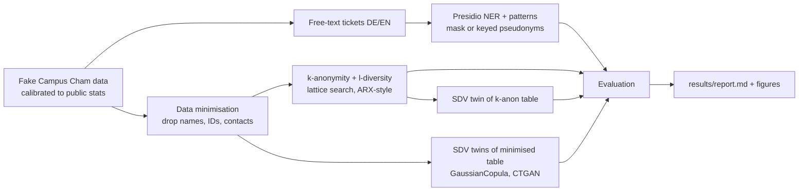

# campus-cham-privacy

Prototype for **Learning Journal 1, use case 1 (confidential big data)**, *AI for Practical Use Cases*, THD Campus Cham, WS 26/27.
Approved by the lecturer on 4 Nov 2026 to go in the journal appendix.

It shows one way to make campus data analysable without exposing anyone:



No real person is in any file. The generator invents 913 students (THD headcount for Cham, WS 25/26) and helpdesk/feedback tickets
with embedded names, matriculation numbers, emails, phones, addresses, birth dates and IBANs. Every inserted
personal-data string is recorded as ground truth, so text masking can be scored.

## Run

```bash
uv sync                      # Python 3.12, CPU-only torch, spaCy en/de models
uv run ccp run               # full pipeline -> results/report.md, results/metrics.json, results/figures/
uv run ccp generate -n 913   # only the fake data -> data/students.csv, data/tickets.csv
uv run ccp bench -n 100000   # scale test: generation, k-anonymity, synthesis on 100k students
```

Options for `run`: `-k 5`, `-l 2` (distinct l-diversity on disability support), `--max-suppression 0.05`,
`-n` students, `-t` tickets, `--ctgan-epochs 300`, `--seed 42`.

## What is measured

| Step | Privacy | Utility |
|---|---|---|
| Free text (Presidio) | recall per entity type, verbatim leak rate, indirect identifiers left | precision (over-masking) |
| k-anonymity | share unique, prosecutor re-identification risk, linkage attack on disability status | generalisation loss, suppression, ML AUC |
| Synthetic twins (SDV) | exact copies, distance to closest record vs unseen real rows, linkage attack | marginal similarity, Cramér's V gap, train-on-synthetic/test-on-real AUC |

## Layout

- `src/ccp/calibration.py`: every distribution parameter with its source key; assumptions are marked.
- `src/ccp/generate.py`: student table + tickets with ground-truth spans.
- `src/ccp/textmask.py`: Presidio analyzer (spaCy `en_core_web_md`, `de_core_news_md`) + custom matriculation/street recognisers; mask or HMAC pseudonyms.
- `src/ccp/kanon.py`: generalisation hierarchies, full-lattice k-anonymity / l-diversity search, re-identification risk.
- `src/ccp/synth.py`: SDV GaussianCopula / CTGAN.
- `src/ccp/evaluate.py`: DCR, linkage attack, marginals, Cramér's V, ML utility, text scores.
- `docs/calibration.md`: sources and the list of assumptions (cite these in the journal).

## Known limits

- The fake data is cleaner than reality (fixed templates, no typos, no rare edge cases beyond the long tail), so measured risk is a **lower bound**. A real validation belongs inside the university's secure environment with the data-protection officer.
- k-anonymity protects against linkage on the chosen quasi-identifiers only; it gives no guarantee against attackers with other background knowledge. Synthetic data has no formal guarantee either unless trained with differential privacy.
- Matriculation-number format and per-programme headcounts are assumptions (see `docs/calibration.md`).
