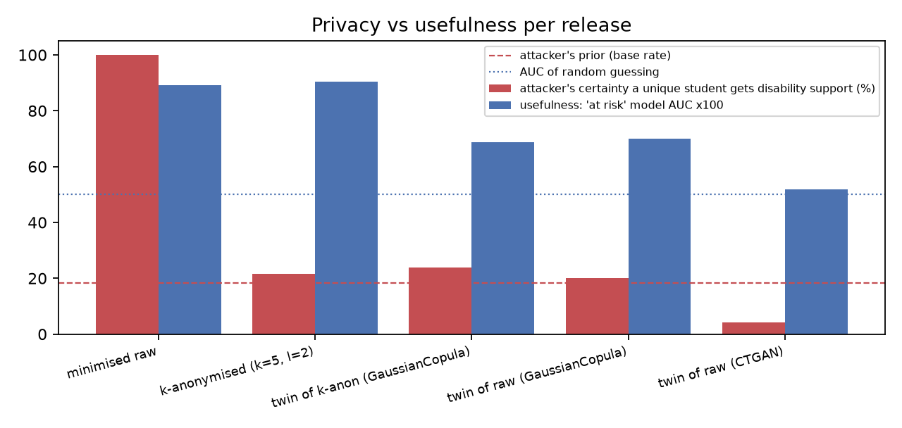

# Campus Cham confidential data pipeline: results

All data is invented (913 students, 600 tickets, seed 42); distributions are calibrated to public statistics (see `docs/calibration.md`). The student table was split into 720 rows used for release and 193 held-out rows that act as 'real people the model never saw'.

Regenerate with `uv run ccp run` — every number below comes from `metrics.json`.

## 1. Why a small campus is risky

Share of students who are the only person with that combination of attributes (in the minimised table, i.e. after names, IDs, contact data and birth dates were already removed):

| attributes known to an attacker   | students unique   |
|:----------------------------------|:------------------|
| nationality + programme           | 4.3 %             |
| + gender                          | 10.1 %            |
| + age                             | 54.2 %            |
| all 6 QIs                         | 83.3 %            |

## 2. Free text: Presidio masking (German + English)

- Ground-truth personal-data spans: 1407
- Direct identifiers detected: **93.4 %**; fully masked: 89.5 %; still readable verbatim: **6.6 %**
- Tickets with no direct identifier left: 84.1 %
- Indirect identifiers (e.g. 'the only student from Ghana in MRO'): on average only 26.5 % of the phrase gets masked — NER is not built for them
- Precision (detections that really were personal data): 88.4 %
- By language: recall EN 92.2 %, DE 96.7 %

| label               |   n | recall   | coverage   | leak_rate   |
|:--------------------|----:|:---------|:-----------|:------------|
| DATE_OF_BIRTH       |  73 | 100.0 %  | 100.0 %    | 0.0 %       |
| EMAIL_ADDRESS       | 135 | 100.0 %  | 100.0 %    | 0.0 %       |
| IBAN_CODE           |  63 | 100.0 %  | 100.0 %    | 0.0 %       |
| INDIRECT_IDENTIFIER | 113 | 99.1 %   | 26.5 %     | 0.9 %       |
| LOCATION            |  80 | 100.0 %  | 100.0 %    | 0.0 %       |
| MATRICULATION_NO    | 237 | 100.0 %  | 100.0 %    | 0.0 %       |
| PERSON              | 568 | 84.9 %   | 80.5 %     | 15.1 %      |
| PHONE_NUMBER        | 138 | 100.0 %  | 100.0 %    | 0.0 %       |

### Examples: keyed pseudonyms (the same string always maps to the same token)

- original: Hello, my name is Elhan Dumanlı (matriculation number 24189137). I cannot access iLearn for Mechatronic and Cyber-Physical Systems since Monday. Please call me on 0157 8889 072.
  - pseudonymised: Hello, my name is PERSON_77f99fb6 (matriculation number MATRICULATION_NO_0ce06b78). I cannot access iLearn for Mechatronic and Cyber-Physical Systems since DATE_TIME_8df4987c. Please call me on PHONE_NUMBER_7bb3d1a2.
- original: Als 27 Jahre alt, aus Sri Lanka, im Studiengang MSS finde ich die Prüfungsorganisation unübersichtlich.
  - pseudonymised: Als 27 Jahre alt, aus LOCATION_90d262fc, im Studiengang MSS finde ich die LOCATION_e32a8b82 unübersichtlich.
- original: Feedback zur Vorlesung bei Herr Bähr: zu viel Stoff in zu wenig Zeit. Ich bin 21 Jahre alt, aus Germany, im Studiengang MDP.
  - pseudonymised: PERSON_f6f172c4 zur Vorlesung bei Herr PERSON_292a55a9: zu viel Stoff in zu wenig Zeit. Ich bin 21 Jahre alt, aus LOCATION_9b94eb76, im Studiengang MDP.
- original: Herr Hörle told me to contact you about my exam registration. My email is athanasios.vlachos@stud.th-deg.de and my phone is +49 178 59272025.
  - pseudonymised: PERSON_18c19c85 told me to contact you about my exam registration. My email is EMAIL_ADDRESS_01032a4a and my phone is PHONE_NUMBER_37c628eb.

### Sample of misses (not fully masked)

| label   | lang   |   coverage | pii_text   | after                                                                                                                               |
|:--------|:-------|-----------:|:-----------|:------------------------------------------------------------------------------------------------------------------------------------|
| PERSON  | de     |       0.44 | Herr Bähr  | <PERSON> zur Vorlesung bei Herr <PERSON>: zu viel Stoff in zu wenig Zeit. Ich bin 21 Jahre alt, aus <LOCATION>, im Studiengang MDP. |
| PERSON  | en     |       0    | Mario      | My room in the dormitory at <LOCATION> has no internet. Contact: <PHONE_NUMBER> (Mario)                                             |

All 249 partially or fully missed spans: `text_misses.csv`.

## 3. Tables: k-anonymity with l-diversity

Searched 1152 generalisation combinations, 166 satisfied k=5 and l=2 (on disability support) with at most 5% rows suppressed. Chosen (lowest information loss 0.44, 34 rows suppressed, 27 groups):

| attribute      | released as   |
|:---------------|:--------------|
| age            | removed       |
| gender         | exact         |
| nationality    | removed       |
| programme      | programme     |
| enrolment_year | exact         |
| postcode       | 1 digit       |

Sample of the released table:

| postcode   | age   | gender   | nationality   | programme   |   enrolment_year |   semester |   ects |   avg_grade | disability_support   | at_risk   |
|:-----------|:------|:---------|:--------------|:------------|-----------------:|-----------:|-------:|------------:|:---------------------|:----------|
| 9****      | *     | male     | *             | MDM         |             2026 |          2 |     15 |         2.3 | False                | True      |
| 9****      | *     | male     | *             | MRO         |             2025 |          3 |     50 |         2.2 | False                | False     |
| 9****      | *     | male     | *             | MDM         |             2024 |          5 |     90 |         1.7 | False                | False     |
| 9****      | *     | male     | *             | MDP         |             2022 |          9 |    100 |         3.2 | True                 | True      |
| 9****      | *     | female   | *             | MDM         |             2026 |          1 |      0 |         2.9 | False                | True      |

## 4. Every release compared

Privacy: *linkage* = share of students who are unique in the real data and can be found in the release by their quasi-identifiers; *belief* = the attacker's average certainty that such a student receives disability support, for students who really do (prior: 18.2 %); *certain* = students whose disability status is revealed with 100 % certainty. Synthetic rows are nobody, so for twins we also check *exact copies* of training rows and the distance to the closest record (DCR) against real rows the model never saw.

Utility: *marginals* = 1 − total variation distance per column (1 = identical); *assoc. gap* = mean change of pairwise Cramér's V (0 = relationships kept); *AUC* = model trained on the release predicting 'at risk' for real unseen students (0.5 = useless).

| release                         |   rows | unique   | linkage   | belief   |   certain | exact copies   |   marginals |   assoc. gap |   AUC |
|:--------------------------------|-------:|:---------|:----------|:---------|----------:|:---------------|------------:|-------------:|------:|
| minimised raw                   |    720 | 83.3 %   | 100.0 %   | 100.0 %  |       103 | –              |       1     |        0     | 0.891 |
| k-anonymised (k=5, l=2)         |    686 | 0.0 %    | 94.7 %    | 21.7 %   |         0 | –              |       0.987 |        0.009 | 0.904 |
| twin of k-anon (GaussianCopula) |    720 | –        | 97.0 %    | 24.0 %   |         0 | 0.0 %          |       0.928 |        0.052 | 0.686 |
| twin of raw (GaussianCopula)    |    720 | –        | 4.5 %     | 20.0 %   |         1 | 0.0 %          |       0.888 |        0.09  | 0.7   |
| twin of raw (CTGAN)             |    720 | –        | 5.3 %     | 4.2 %    |         0 | 0.0 %          |       0.917 |        0.105 | 0.519 |

## 5. A real analyst question: average grade by programme

| programme   |   real (minimised) |   twin of raw (GaussianCopula) |   twin of raw (CTGAN) |
|:------------|-------------------:|-------------------------------:|----------------------:|
| MDM         |               1.89 |                           2    |                  1.84 |
| MDP         |               2.23 |                           1.95 |                  1.83 |
| MMC         |               1.89 |                           1.89 |                  1.85 |
| MRO         |               1.91 |                           2    |                  1.76 |
| MSS         |               1.82 |                           1.9  |                  1.77 |

On the k-anonymised level (programme generalised as chosen above):

| programme   |   real |   k-anonymised |   twin of k-anon |
|:------------|-------:|---------------:|-----------------:|
| MDM         |   1.89 |           1.9  |             2    |
| MDP         |   2.23 |           2.25 |             2.02 |
| MMC         |   1.89 |           1.9  |             1.97 |
| MRO         |   1.91 |           1.9  |             2.05 |
| MSS         |   1.82 |           1.83 |             1.95 |

## 6. Runtime (laptop CPU)

| step                        |   seconds |
|:----------------------------|----------:|
| generate_students           |      2.1  |
| generate_tickets            |      0.73 |
| presidio_mask               |     28.41 |
| presidio_pseudonymise       |      0.18 |
| k_anonymity                 |      5.03 |
| twin_k_anon_gaussian_copula |      1.64 |
| twin_raw_gaussian_copula    |      1.46 |
| twin_raw_ctgan              |    185.85 |
