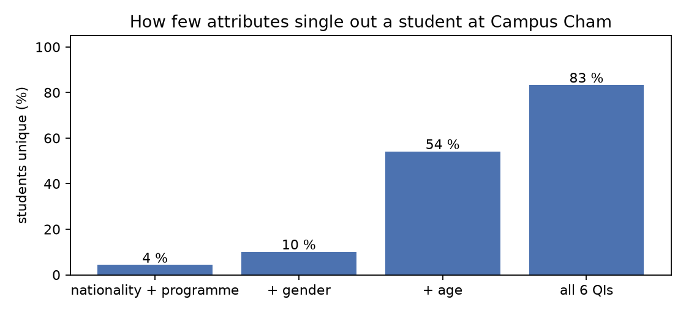
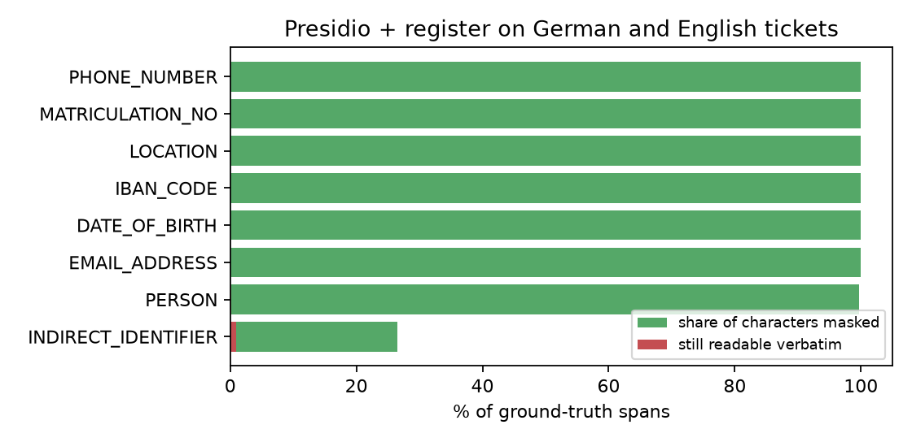
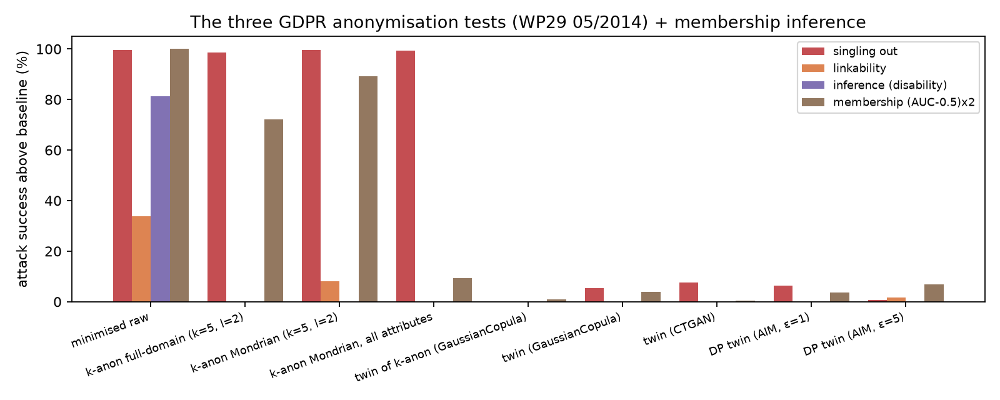
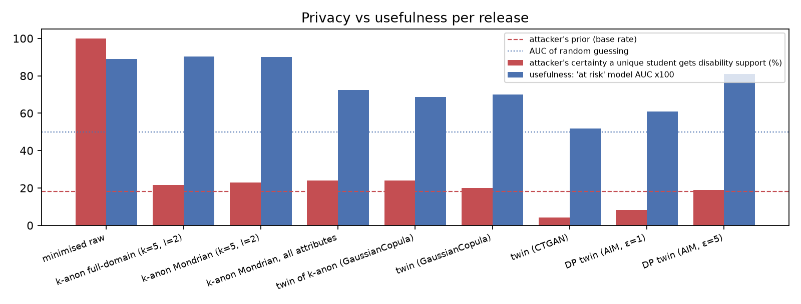
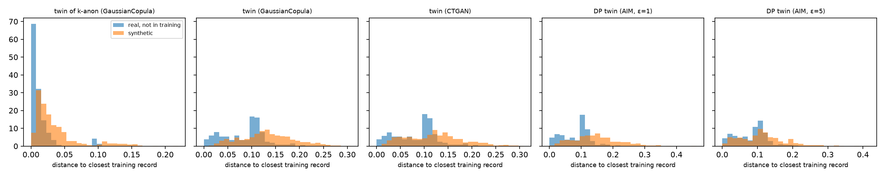
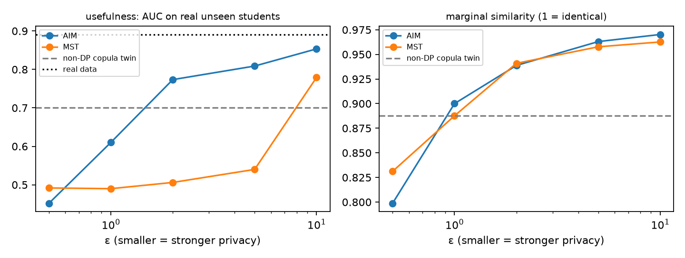

# Campus Cham confidential data pipeline: results

All data is invented (913 students, 600 tickets, seed 42); distributions are calibrated to public statistics (see `docs/calibration.md`). The student table was split into 720 rows used for release and 193 held-out rows that act as 'real people the model never saw'.

Regenerate with `uv run ccp run` — every number below comes from `metrics.json`.

## 1. Why a small campus is risky

Share of students who are the only person with that combination of attributes (in the minimised table, i.e. after names, IDs, contact data and birth dates were already removed):

| attributes known to an attacker   | students unique   |
|:----------------------------------|:------------------|
| nationality + programme           | 4.3 %             |
| + gender                          | 10.1 %            |
| + age                             | 54.2 %            |
| all 6 QIs                         | 83.3 %            |

## 2. Free text

### 2.1 Direct identifiers: three detection pipelines

*register* = names from the university's own enrolment and staff register used as a deny-list (the university already holds them; nothing new is collected).

| pipeline          | detected   | readable verbatim   | indirect phrases masked   | precision   | names readable   |   seconds |
|:------------------|:-----------|:--------------------|:--------------------------|:------------|:-----------------|----------:|
| spaCy             | 93.4 %     | 6.6 %               | 26.5 %                    | 88.4 %      | 15.1 %           |      6.8  |
| spaCy + register  | 99.9 %     | 0.1 %               | 26.5 %                    | 89.3 %      | 0.2 %            |      7.04 |
| GLiNER + register | 100.0 %    | 0.0 %               | 2.5 %                     | 99.9 %      | 0.0 %            |    185.52 |

Detail for the pipeline used downstream (**spaCy + register**), 1407 ground-truth spans:

| label               |   n | recall   | coverage   | leak_rate   |
|:--------------------|----:|:---------|:-----------|:------------|
| DATE_OF_BIRTH       |  73 | 100.0 %  | 100.0 %    | 0.0 %       |
| EMAIL_ADDRESS       | 135 | 100.0 %  | 100.0 %    | 0.0 %       |
| IBAN_CODE           |  63 | 100.0 %  | 100.0 %    | 0.0 %       |
| INDIRECT_IDENTIFIER | 113 | 99.1 %   | 26.5 %     | 0.9 %       |
| LOCATION            |  80 | 100.0 %  | 100.0 %    | 0.0 %       |
| MATRICULATION_NO    | 237 | 100.0 %  | 100.0 %    | 0.0 %       |
| PERSON              | 568 | 99.8 %   | 99.8 %     | 0.2 %       |
| PHONE_NUMBER        | 138 | 100.0 %  | 100.0 %    | 0.0 %       |

### 2.2 Indirect identifiers ('the only student from Ghana in MRO')

NER does not understand that age + origin + programme together identify someone. A rule-based step coarsens self-descriptions after Presidio (country → world region, age → decade, programme → degree, gender words and 'the only' removed). *Anonymity set* = how many students match what the text still reveals.

|                                |   texts with a self-description | writer unique (set = 1)   |   median anonymity set |   smallest set |
|:-------------------------------|--------------------------------:|:--------------------------|-----------------------:|---------------:|
| after Presidio + register      |                             113 | 0.9 %                     |                     54 |              1 |
| after indirect-identifier step |                             113 | 0.0 %                     |                    913 |              6 |

Examples:

- [de] Als 27 Jahre alt, aus <LOCATION>, im Studiengang MSS finde ich die <LOCATION> unübersichtlich.
  - → Als Person in den Zwanzigern, aus <LOCATION>, in einem Masterstudiengang finde ich die <LOCATION> unübersichtlich.
- [de] <PERSON> zur Vorlesung bei <PERSON>: zu viel Stoff in zu wenig Zeit. Ich bin 21 Jahre alt, aus <LOCATION>, im Studiengang MDP.
  - → <PERSON> zur Vorlesung bei <PERSON>: zu viel Stoff in zu wenig Zeit. Ich bin in den Zwanzigern, aus <LOCATION>, in einem Bachelorstudiengang.
- [en] As a <DATE_TIME> female student from <LOCATION> in MSS, I feel that the course materials assume prior knowledge from <NRP> universities.
  - → As a <DATE_TIME> student from <LOCATION> in a Master's programme, I feel that the course materials assume prior knowledge from <NRP> universities.
- [en] Feedback on the lab course: the robot cell was broken twice. I am a <DATE_TIME> male student from <LOCATION> in MDM, so the group work was hard for me. - <PERSON>
  - → Feedback on the lab course: the robot cell was broken twice. I am a <DATE_TIME> student from <LOCATION> in a Master's programme, so the group work was hard for me. - <PERSON>

A local LLM rewrite (Qwen2.5-1.5B on CPU) was tested as an alternative: see `docs/llm_rewrite.md`.

### 2.3 Keyed pseudonyms (the same string always maps to the same token)

- original: Hello, my name is Elhan Dumanlı (matriculation number 24189137). I cannot access iLearn for Mechatronic and Cyber-Physical Systems since Monday. Please call me on 0157 8889 072.
  - pseudonymised: Hello, my name is PERSON_77f99fb6 (matriculation number MATRICULATION_NO_0ce06b78). I cannot access iLearn for Mechatronic and Cyber-Physical Systems since DATE_TIME_8df4987c. Please call me on PHONE_NUMBER_7bb3d1a2.
- original: Als 27 Jahre alt, aus Sri Lanka, im Studiengang MSS finde ich die Prüfungsorganisation unübersichtlich.
  - pseudonymised: Als 27 Jahre alt, aus LOCATION_90d262fc, im Studiengang MSS finde ich die LOCATION_e32a8b82 unübersichtlich.
- original: Feedback zur Vorlesung bei Herr Bähr: zu viel Stoff in zu wenig Zeit. Ich bin 21 Jahre alt, aus Germany, im Studiengang MDP.
  - pseudonymised: PERSON_f6f172c4 zur Vorlesung bei PERSON_150a3cc5: zu viel Stoff in zu wenig Zeit. Ich bin 21 Jahre alt, aus LOCATION_9b94eb76, im Studiengang MDP.

### 2.4 Remaining misses of direct identifiers

| label   | lang   |   coverage | pii_text   |
|:--------|:-------|-----------:|:-----------|
| PERSON  | en     |       0.62 | Vũ Hoàng   |
| PERSON  | en     |       0    | Vũ         |

All 115 partially or fully missed spans (incl. indirect phrases): `text_misses.csv`.

## 3. Tables: k-anonymity with l-diversity

Goal: every student shares their quasi-identifiers with at least k=5 others, and every such group contains students with and without disability support (l=2).

**Full-domain** (ARX-style): searched 1152 combinations of one generalisation level per attribute, 166 were valid with ≤ 5% suppression; best:

| attribute      | released as   |
|:---------------|:--------------|
| age            | removed       |
| gender         | exact         |
| nationality    | removed       |
| programme      | programme     |
| enrolment_year | exact         |
| postcode       | 1 digit       |

**Mondrian** (local recoding): splits the students into groups top-down, so each group gets its own level of detail; a large group of Indian Master's students can keep 'South Asia' while a rare nationality falls back to 'International'.

| method                                |   information loss (NCP, 0 = raw) |   groups |   suppressed | nationality kept as country/region   |
|:--------------------------------------|----------------------------------:|---------:|-------------:|:-------------------------------------|
| full-domain (one level per attribute) |                             0.51  |       27 |           34 | 0.0 %                                |
| Mondrian (per-group recoding)         |                             0.271 |       83 |            0 | 80.8 %                               |
| Mondrian, grades/credits/semester too |                             0.278 |       92 |            0 | 79.4 %                               |

(The last row also generalises grades, credits and semester, so its loss is measured over more columns.)

Mondrian release, first rows:

| postcode   | age   | gender   | nationality           | programme   | enrolment_year   |   semester |   ects |   avg_grade | disability_support   | at_risk   |
|:-----------|:------|:---------|:----------------------|:------------|:-----------------|-----------:|-------:|------------:|:---------------------|:----------|
| 934**      | 23-26 | male     | Middle East/N. Africa | Master      | 2026             |          2 |     15 |         2.3 | False                | True      |
| 934**      | 23-26 | male     | Middle East/N. Africa | Master      | 2024-2025        |          3 |     50 |         2.2 | False                | False     |
| 934**      | 24-27 | *        | South Asia            | MDM         | 2024-2025        |          5 |     90 |         1.7 | False                | False     |
| 94469      | 22-25 | male     | Germany               | MDP         | 2022-2023        |          9 |    100 |         3.2 | True                 | True      |
| 9****      | 23-35 | female   | *                     | MDM         | 2026             |          1 |      0 |         2.9 | False                | True      |

## 4. Every release attacked

**GDPR test** (Article 29 Working Party, Opinion 05/2014: data is anonymous only if no one can *single out* a person, *link* records about them, or *infer* facts about them), measured with Anonymeter: risk = attack success above a random-guess baseline, normalised (0 = no better than guessing, 1 = always right). Real held-out students act as a control, so the risk reflects what the release leaks rather than what can be guessed about anyone. *Membership* = can an attacker tell whether a student was in the data (AUC 0.5 = no).

**Usefulness**: *marginals* = 1 − total variation distance per column; *assoc. gap* = mean change of pairwise Cramér's V; *AUC* = model trained on the release predicting 'at risk' for real unseen students.

| release                         | unique   |   singling out |   linkability |   inference |   membership AUC |   certain disclosures | exact copies   | marginals   | assoc. gap   |   AUC |
|:--------------------------------|:---------|---------------:|--------------:|------------:|-----------------:|----------------------:|:---------------|:------------|:-------------|------:|
| minimised raw                   | 83.3 %   |           1    |          0.34 |        0.81 |             1    |                   103 | –              | –           | –            | 0.891 |
| k-anon full-domain (k=5, l=2)   | 0.0 %    |           0.99 |          0    |        0    |             0.86 |                     0 | –              | –           | –            | 0.904 |
| k-anon Mondrian (k=5, l=2)      | 0.0 %    |           1    |          0.08 |        0    |             0.95 |                     0 | –              | –           | –            | 0.901 |
| k-anon Mondrian, all attributes | 0.0 %    |           0.99 |          0    |        0    |             0.55 |                     0 | –              | –           | –            | 0.724 |
| twin of k-anon (GaussianCopula) | –        |           0    |          0    |        0    |             0.5  |                     0 | 0.0 %          | 0.928       | 0.052        | 0.686 |
| twin (GaussianCopula)           | –        |           0.05 |          0    |        0    |             0.52 |                     1 | 0.0 %          | 0.887       | 0.090        | 0.7   |
| twin (CTGAN)                    | –        |           0.08 |          0    |        0    |             0.5  |                     0 | 0.0 %          | 0.917       | 0.105        | 0.519 |
| DP twin (AIM, ε=1)              | –        |           0.06 |          0    |        0    |             0.52 |                     0 | 0.0 %          | 0.900       | 0.123        | 0.61  |
| DP twin (AIM, ε=5)              | –        |           0.01 |          0.02 |        0    |             0.53 |                     1 | 0.0 %          | 0.963       | 0.048        | 0.809 |

Attack caveats reported by the evaluator ('as good or worse as baseline' = the attack learned nothing, reported as risk 0):

- *k-anon full-domain (k=5, l=2)*: anonymeter singling out (multivariate): Reached maximum number of attempts 50000 when generating singling out queries. Returning 183 instead of the requested 500.
- *k-anon Mondrian, all attributes*: anonymeter singling out (univariate): no univariate query isolates a single release record; reporting risk 0
- *twin of k-anon (GaussianCopula)*: anonymeter inference: Attack is as good or worse as baseline model. Estimated rates: attack = 0.6346261105702292, baseline = 0.6651074940955642. Analysis results cannot be trusted.
- *twin of k-anon (GaussianCopula)*: anonymeter singling out (multivariate): Reached maximum number of attempts 50000 when generating singling out queries. Returning 286 instead of the requested 500.
- *twin (GaussianCopula)*: anonymeter inference: Attack is as good or worse as baseline model. Estimated rates: attack = 0.6498668023328967, baseline = 0.6651074940955642. Analysis results cannot be trusted.
- *twin (GaussianCopula)*: anonymeter singling out (univariate): Attack is as good or worse as baseline model. Estimated rates: attack = 0.03853678154279019, baseline = 0.03853678154279019. Analysis results cannot be trusted.
- *twin (CTGAN)*: anonymeter inference: Attack is as good or worse as baseline model. Estimated rates: attack = 0.6600272635080083, baseline = 0.6752679552706758. Analysis results cannot be trusted.
- *DP twin (AIM, ε=1)*: anonymeter inference: Attack is as good or worse as baseline model. Estimated rates: attack = 0.6803481858582316, baseline = 0.700669108208455. Analysis results cannot be trusted.
- *DP twin (AIM, ε=1)*: anonymeter singling out (univariate): Attack is as good or worse as baseline model. Estimated rates: attack = 0.12941648348401585, baseline = 0.12941648348401585. Analysis results cannot be trusted.
- *DP twin (AIM, ε=5)*: anonymeter singling out (univariate): Attack is as good or worse as baseline model. Estimated rates: attack = 0.1387663999314446, baseline = 0.21101311994515567. Analysis results cannot be trusted.

## 5. Differential privacy: how much privacy costs

ε bounds how much any single student can change the output: with ε = 1 an attacker's odds about any fact on one student rise by at most a factor e ≈ 2.7 (except with probability δ = 10⁻⁹), whatever else they know. Smaller ε = stronger guarantee, noisier data. All bins and category lists come from public sources, so the guarantee covers the whole release.

| model   |   epsilon |   marginal_similarity |   association_gap |   ml_auc_at_risk | belief_if_true   |   runtime_s |
|:--------|----------:|----------------------:|------------------:|-----------------:|:-----------------|------------:|
| mst     |       0.5 |                 0.831 |             0.195 |            0.492 | 0.0 %            |       17.8  |
| mst     |       1   |                 0.888 |             0.162 |            0.49  | 0.0 %            |       21    |
| mst     |       2   |                 0.941 |             0.074 |            0.506 | 15.6 %           |       17.51 |
| mst     |       5   |                 0.958 |             0.071 |            0.54  | 36.4 %           |       32.36 |
| mst     |      10   |                 0.963 |             0.059 |            0.779 | 10.0 %           |       35.7  |
| aim     |       0.5 |                 0.799 |             0.137 |            0.452 | 0.0 %            |       13.15 |
| aim     |       1   |                 0.9   |             0.123 |            0.61  | 8.3 %            |       23.18 |
| aim     |       2   |                 0.939 |             0.098 |            0.774 | 20.0 %           |       22.85 |
| aim     |       5   |                 0.963 |             0.048 |            0.809 | 19.0 %           |       39.63 |
| aim     |      10   |                 0.97  |             0.036 |            0.853 | 22.7 %           |      114.18 |

## 6. A real analyst question: average grade by programme

| programme   |   real |   twin (GaussianCopula) |   twin (CTGAN) |   DP twin (AIM, ε=1) |   DP twin (AIM, ε=5) |   k-anon Mondrian (k=5, l=2) |
|:------------|-------:|------------------------:|---------------:|---------------------:|---------------------:|-----------------------------:|
| MDM         |   1.89 |                    2    |           1.84 |                 2.01 |                 1.95 |                         1.9  |
| MDP         |   2.23 |                    1.95 |           1.83 |                 1.99 |                 1.95 |                         2.23 |
| MMC         |   1.89 |                    1.89 |           1.85 |                 2.03 |                 1.98 |                         1.86 |
| MRO         |   1.91 |                    2    |           1.76 |                 1.99 |                 1.97 |                         1.85 |
| MSS         |   1.82 |                    1.9  |           1.77 |                 2.12 |                 1.96 |                         1.77 |

## 7. Runtime (laptop CPU, 8 cores)

| step                                    |   seconds |
|:----------------------------------------|----------:|
| generate students                       |      0.37 |
| generate tickets                        |      0.14 |
| text: spaCy                             |      6.8  |
| text: spaCy + register                  |      7.04 |
| text: GLiNER + register                 |    185.52 |
| full-domain k-anonymity                 |      1.74 |
| Mondrian k-anonymity                    |      0.14 |
| Mondrian k-anonymity, all attributes    |      0.24 |
| twin: GaussianCopula of k-anon          |      0.75 |
| twin: GaussianCopula                    |      0.69 |
| twin: CTGAN                             |     24.38 |
| twin: DP AIM eps=1                      |     57.04 |
| twin: DP AIM eps=5                      |     68.29 |
| attack: minimised raw                   |     14.79 |
| attack: k-anon full-domain (k=5, l=2)   |      9.8  |
| attack: k-anon Mondrian (k=5, l=2)      |      4.23 |
| attack: k-anon Mondrian, all attributes |      2.67 |
| attack: twin of k-anon (GaussianCopula) |      8.78 |
| attack: twin (GaussianCopula)           |      2.27 |
| attack: twin (CTGAN)                    |      2.21 |
| attack: DP twin (AIM, ε=1)              |      4.01 |
| attack: DP twin (AIM, ε=5)              |      3.61 |
| epsilon sweep mst                       |    130.05 |
| epsilon sweep aim                       |    217.96 |
